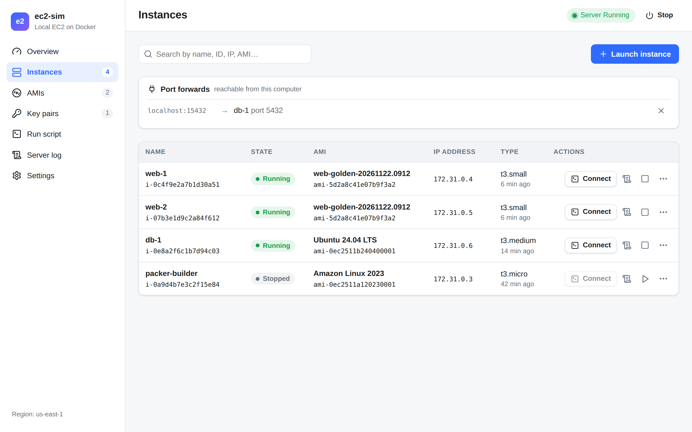

# ec2-sim documentation

Guides for using ec2-sim, the local EC2 simulator where instances are Docker
containers and AMIs are Docker images. The [main README](../README.md) is the
reference: every feature, command and setting in one page. These guides walk
through tasks end to end.

| Guide | Read it when you want to… |
|---|---|
| [Why ec2-sim](why-ec2-sim.md) | decide whether it fits your team, and what it saves |
| [Getting started](getting-started.md) | install it and launch, connect to and bake your first instance |
| [Desktop app](desktop-app.md) | do all of that from the GUI (Windows, macOS, Linux) |
| [Baking AMIs](baking-amis.md) | build AMIs by hand, with Packer, or by running your existing build script unmodified |
| [Networking](networking.md) | connect instances to each other, and reach them from your computer by name |
| [Stacks](stacks.md) | describe a whole environment (VPCs, security groups, instances, readiness) in one file and bring it up with one command |
| [Multi-tier testing](multi-tier-testing.md) | run an app and its databases together in a VPC that mirrors production |
| [Troubleshooting](troubleshooting.md) | fix something that doesn't work |
| [Architecture](architecture.md) | understand how it works, or contribute |

