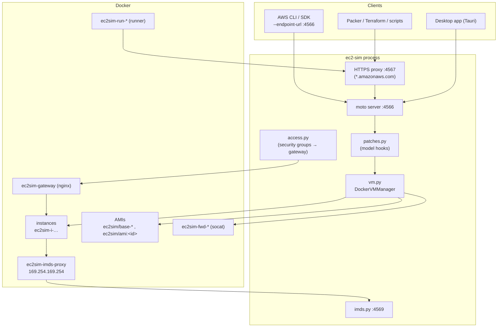

# Architecture

ec2-sim is a [moto](https://github.com/getmoto/moto) server whose EC2 model is
patched so that lifecycle calls also drive Docker. moto owns the API surface:
request parsing, validation, responses, filters, and every resource ec2-sim
doesn't simulate itself. ec2-sim adds the parts that make instances real.



## Code map

| File | Role |
|---|---|
| `ec2sim/server.py` | CLI (`serve`, `run`, `forward`, `gateway`, `cleanup`, …) and startup order |
| `ec2sim/patches.py` | Hooks on moto's EC2 model: `RunInstances` → boot a container, start/stop/reboot/terminate, `CreateImage` (bakes in a background thread: pending → available), `CopyImage`, `RegisterImage docker://`, `DeregisterImage`, `_custom_id_` for security groups |
| `ec2sim/vm.py` | Everything Docker: per-VPC networks, IP and DNS aliases, systemd run options, commit with the `/etc/hosts` label, IMDS proxy, bastion, port forwards, the gateway's nginx config |
| `ec2sim/access.py` | Works out which instance ports the gateway allows (security group rules from IP ranges, `ec2sim:web` tag, open mode) and resyncs every 2 s |
| `ec2sim/imds.py` | Instance metadata (IMDSv1/v2), user data, identity document, instance-profile credentials |
| `ec2sim/run.py` | `ec2-sim run`: the disposable runner container |
| `ec2sim/catalog.py` | Base AMIs and `EC2SIM_AMI_ALIASES` |
| `ec2sim/config.py` | All `EC2SIM_*` settings |
| `images/` | Base AMIs (`amazonlinux-2023`, `ubuntu-24.04`, `ubuntu-18.04` / `ubuntu-26.04` with systemd), `runner`, `bastion`, `forwarder`, shared init scripts |
| `ui/` | Desktop app: Rust backend (`src-tauri/`), React frontend (`src/`), screenshot harness (`screenshots/`) |

## Key decisions

- **Containers, not VMs.** Boot in seconds, `docker commit` as `CreateImage`, and
  no hypervisor. The cost is a shared kernel: no custom kernels, kernel modules
  or Windows AMIs.
- **systemd instances** run privileged with a private cgroup namespace and
  tmpfs `/run`, so provisioning that uses `systemctl` behaves as on a VM.
  `systemd-binfmt` is masked: binfmt_misc is shared with the host kernel, and
  resetting it broke WSL interop.
- **AMIs are labelled images.** The labels (`ec2sim.ami_id`, account, region,
  name, `ec2sim.etc_hosts`) are the source of truth. AMIs are restored from
  Docker on every start; the rest of the moto state is in memory.
- **`CreateImage` is asynchronous**, like AWS. Clients see `pending`, and a
  commit of several GB doesn't hit a client timeout.
- **The gateway follows security groups**, so "who can reach what" uses the
  same model as AWS, and the desktop app edits real rules instead of a private
  list.
- **Fake credentials by design.** The runner and the proxy are meant to run
  with fake AWS credentials, so a call that escapes the simulation fails
  instead of touching a real account.

## Tests

```bash
uv run pytest -q tests/unit   # access rules, /etc/hosts handling (no server needed)
./tests/smoke.sh              # end to end with the AWS CLI (server running)
./tests/e2e/run-packer.sh     # Packer amazon-ebs build (server running)
cd ui && npx tsc --noEmit && cargo test --manifest-path src-tauri/Cargo.toml
```

## Contributing

- Keep the README generic: no project- or company-specific examples.
- New base AMI: see [Adding a base AMI](../README.md#adding-a-base-ami).
- UI change: run `npm run screenshots` in `ui/` and commit the updated
  `docs/images/` (see [Desktop app → Updating the screenshots](desktop-app.md#updating-the-screenshots)).
- Docs change: edit `docs/` (never the wiki directly), then run
  `python3 scripts/sync-wiki.py` to publish it to the
  [wiki](https://github.com/danztensai/ec2-sim/wiki).
