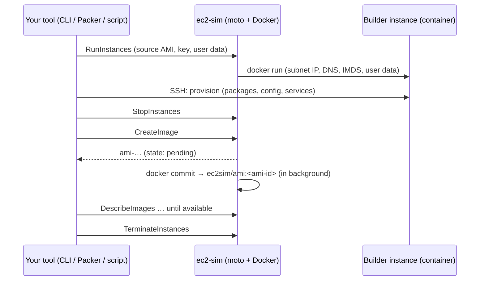

# Baking AMIs

You can make an AMI in three ways, from quick to faithful:

1. **By hand**: launch, customise, `CreateImage`.
2. **With Packer**: your `amazon-ebs` template, pointed at ec2-sim.
3. **Your existing build script, unmodified**: `ec2-sim run` (or the app's
   **Run script** page) runs it exactly as a build host would.

Whichever you use, the result is a Docker image `ec2sim/ami:<ami-id>` that
survives restarts and launches like any AMI.

## How baking works



The bake keeps everything on the filesystem, including installed packages,
enabled systemd units and files in `/etc`. Entries a provisioner adds to
`/etc/hosts` are kept too: Docker manages that file, so ec2-sim stores them
with the AMI and restores them on instances launched from it.

## 1. By hand

See [Getting started, step 6](getting-started.md#6-bake-an-ami-and-launch-a-copy),
or in the app: **Instances → ⋯ → Create AMI**.

## 2. With Packer

Point the `amazon-ebs` builder at ec2-sim:

```hcl
source "amazon-ebs" "web" {
  region                     = "us-east-1"
  access_key                 = "test"
  secret_key                 = "test"
  custom_endpoint_ec2        = "http://localhost:4566"
  skip_credential_validation = true
  skip_region_validation     = true
  skip_metadata_api_check    = true
  ssh_interface              = "public_ip"

  source_ami_filter {
    filters = { name = "al2023-ami-*-x86_64" }
    owners  = ["amazon"]
    most_recent = true
  }
  instance_type = "t3.micro"
  ssh_username  = "ec2-user"
  ami_name      = "web-golden-{{timestamp}}"
}
```

Working example: [`tests/e2e/al2023-web.pkr.hcl`](../tests/e2e/al2023-web.pkr.hcl)
(`./tests/e2e/run-packer.sh`). On Docker Desktop, add the
[bastion settings](../README.md#macos-and-docker-desktop).

## 3. Run your existing build script unmodified

Real pipelines are wrapper scripts. They call Packer with hard-coded regions,
look up AMIs by ID, read secrets, and call the AWS CLI. To test the real
thing, run the script itself:

```bash
export VAULT_ROLE_ID=… VAULT_SECRET_ID=…        # whatever your script reads
uv run ec2-sim run -C ~/work/infra --region us-west-2 \
  -e VAULT_ROLE_ID -e VAULT_SECRET_ID -- './build-ami.sh --env staging'
```

`ec2-sim run` starts a disposable **runner container** (`images/runner`) with:

| | |
|---|---|
| Tools | Packer 1.16 + Amazon plugin, AWS CLI v2, jq, sudo, curl, git, `tempfile` |
| Your folder | mounted **at the same path**, so relative paths and log files work |
| AWS | every `*.amazonaws.com` call goes through ec2-sim's HTTPS proxy, with its CA trusted, so no endpoint flags are needed |
| Credentials | **fake ones only**; your real AWS credentials are never passed in |
| Network | the host network, so Packer can SSH to instance IPs |
| Variables | `-e NAME` copies `NAME` from your environment; values never appear on a command line |

`ec2-sim stop-runs` stops it. The desktop app's **Run script** page is the same
thing with a form (see [Desktop app](desktop-app.md#run-script)).

### Getting an existing pipeline to run

| Symptom | Fix |
|---|---|
| The script uses a fixed source AMI ID (`ami-0abc…`) | `EC2SIM_AMI_ALIASES=ami-0abc…=ubuntu-26.04` maps it to a base AMI. Pick a **systemd** base if the build uses `systemctl`. |
| It expects resources to exist already (instance profile, security group, key pair) | Create them first with the AWS CLI against `http://localhost:4566`. Use the [`_custom_id_` tag](../README.md#custom-resource-ids) when the ID is hard-coded. |
| `/bin/bash^M: bad interpreter` | CRLF line endings from a Windows checkout. Clone the repository inside WSL. |
| It fetches secrets (e.g. Vault) | Pass them with `-e`. Use a **non-production** role: a baked AMI contains whatever the build wrote to disk. |
| Packer waits forever for SSH | You're on Docker Desktop: add the bastion settings, or run with `ec2-sim run` (host network). |

### What to check after a bake

```bash
ec2 describe-images --owners self --query 'Images[].[ImageId,Name,State]' --output table
ec2 run-instances --image-id ami-<new> --instance-type t3.large --tag-specifications 'ResourceType=instance,Tags=[{Key=Name,Value=check-1}]'
docker exec ec2sim-i-<id> systemctl is-system-running     # systemd AMIs: "running"
docker exec ec2sim-i-<id> systemctl --failed
docker exec ec2sim-i-<id> journalctl -u <your-service> -n 50
```

If services start but keep restarting because they can't reach a database,
continue with [Multi-tier testing](multi-tier-testing.md).

## Keep secrets out of shared AMIs

AMIs and instances are Docker images and containers on your machine. If your
build renders secrets to disk (an env file, for example), the AMI contains
them. Deregister such AMIs when you're done (`ec2 deregister-image`), don't
`docker push` them, and use staging credentials rather than production ones.
