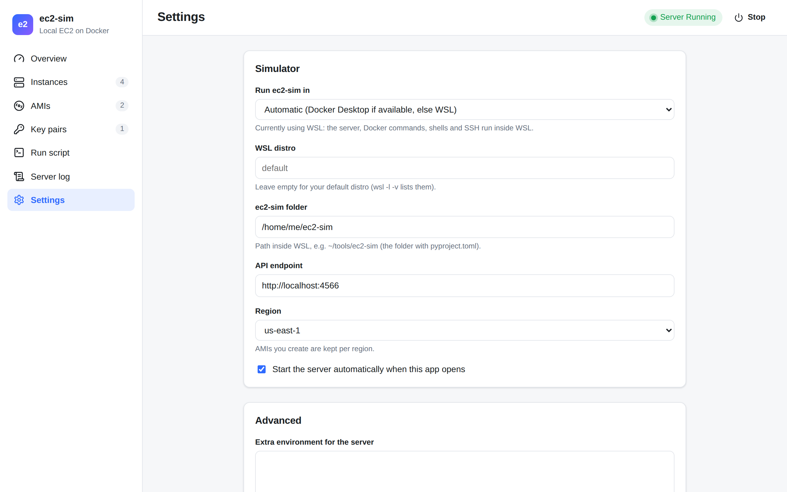
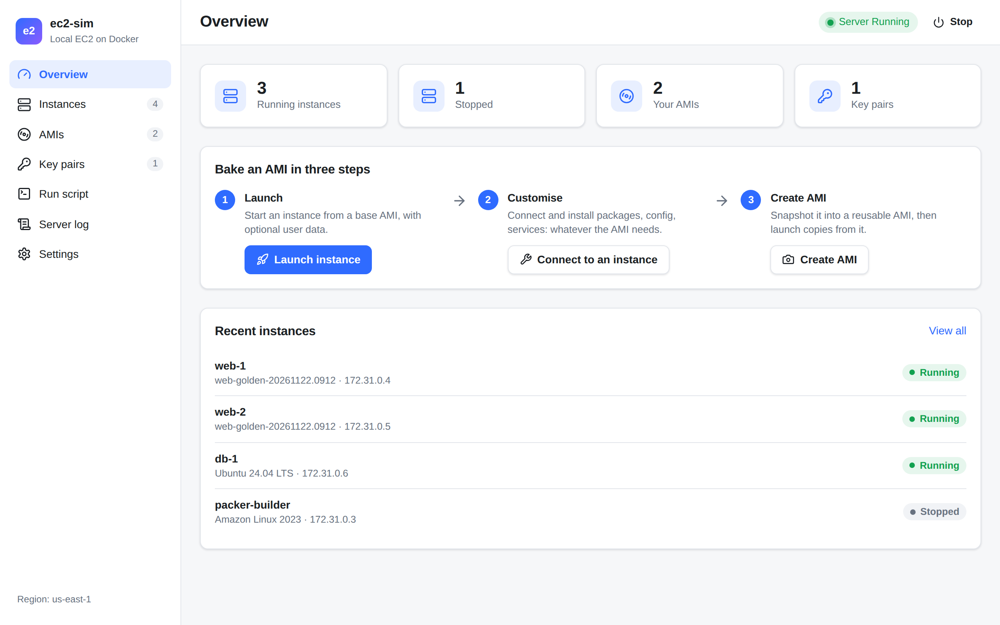
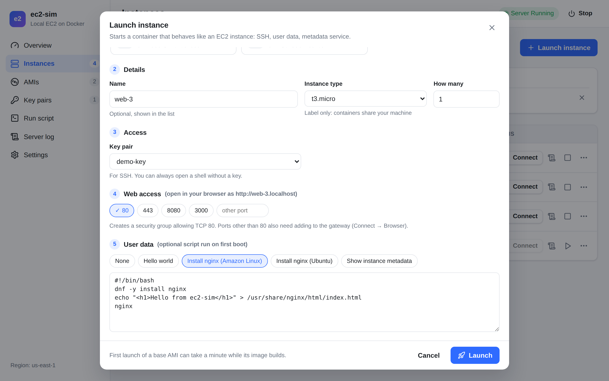
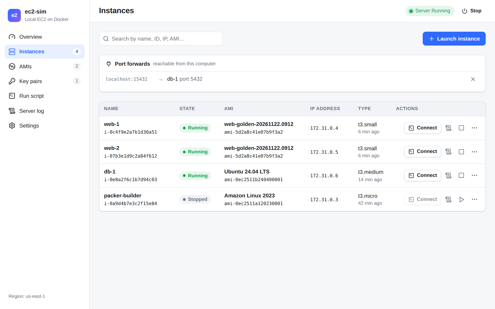
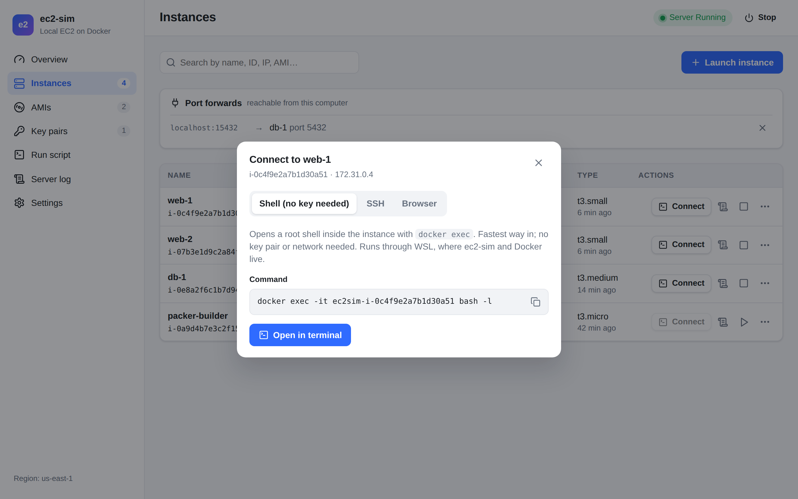
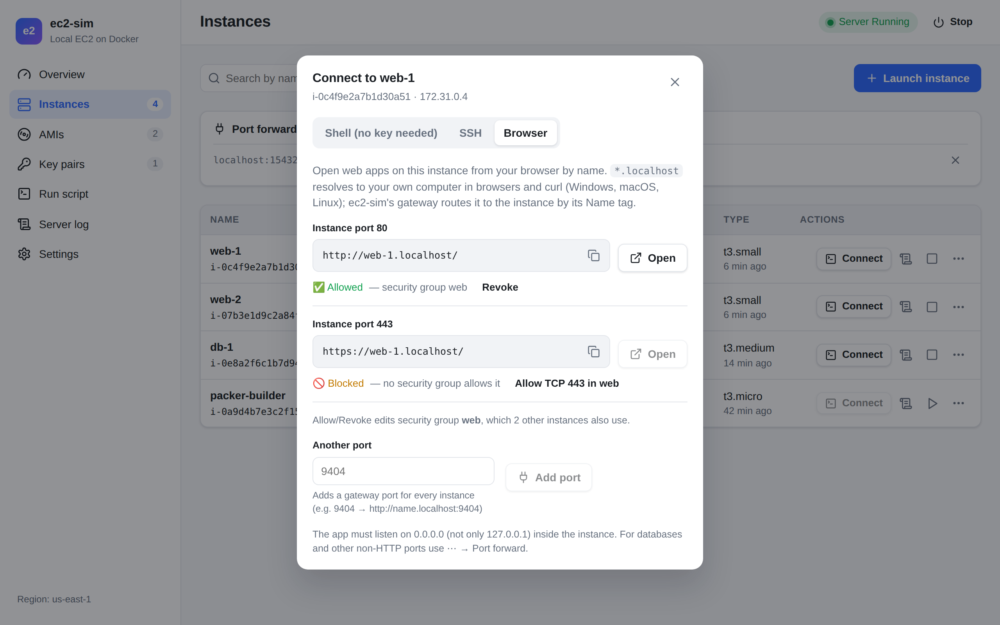
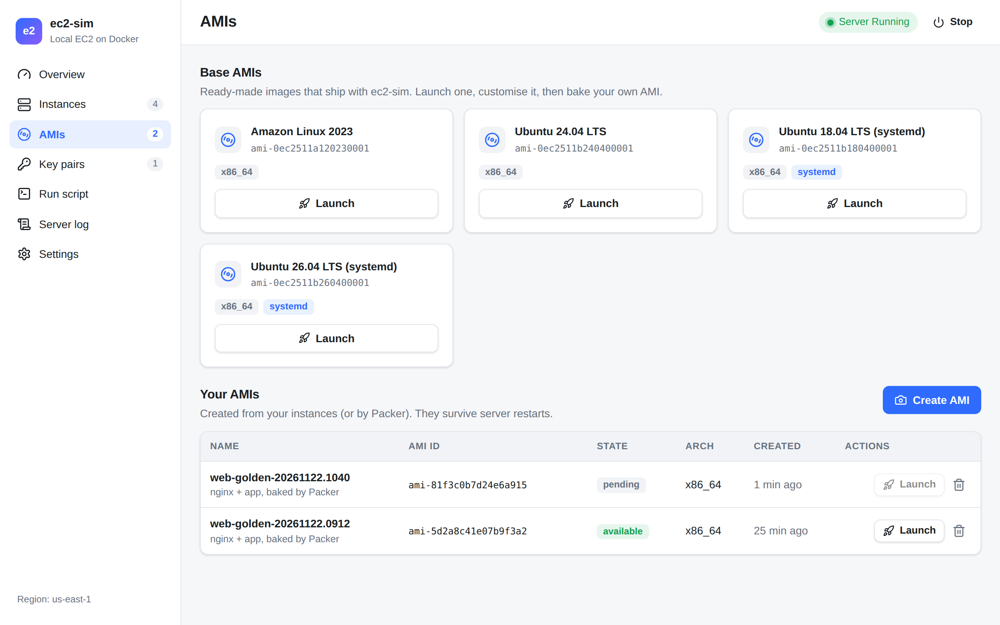
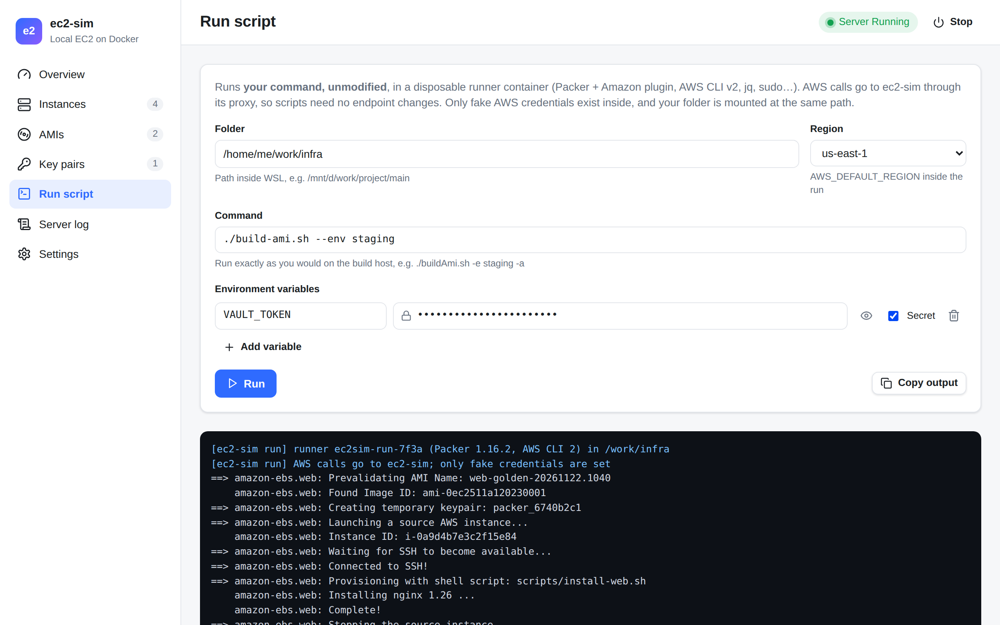
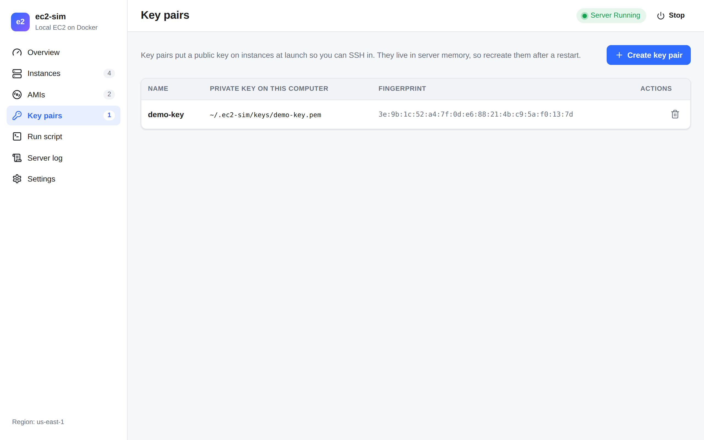
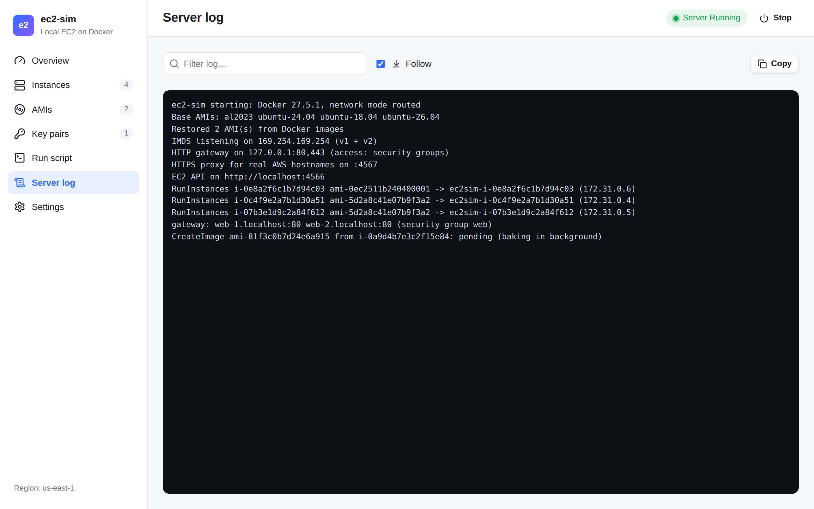

# Desktop app

The desktop app ([`ui/`](../ui/README.md), Tauri 2 + React) does everything in
[Getting started](getting-started.md) without the command line. It starts and
stops the simulator, launches and connects to instances, bakes AMIs and runs
your build scripts.

The screenshots use demo data. To regenerate them, see
[Updating the screenshots](#updating-the-screenshots).

## Install and run

| Your machine | How |
|---|---|
| Windows | Build the native Windows app; it drives ec2-sim inside WSL. See [Windows with ec2-sim in WSL](../ui/README.md#windows-with-ec2-sim-in-wsl-recommended-on-windows). |
| macOS / Linux | `cd ui && npm install && npm run tauri build`, or `npm run tauri dev`. |

On first start, check **Settings**: the ec2-sim folder (a WSL path such as
`/home/you/ec2-sim` on Windows), the region, and whether to start the server
automatically.



## Start the server

Press **Start** in the top bar. The app runs `ec2-sim` from your checkout,
streams its log to **Server log**, and stops it cleanly when you press
**Stop** or quit, which removes the instance containers. If a server was
already running when the app started, the top bar labels it *external*, and the
app leaves it running when it quits.

## Overview

The counts, the three bake steps (Launch → Customise → Create AMI) and your
most recent instances, each with a shortcut.



## Launch an instance

**Instances → Launch instance** opens a single-page wizard:

1. **AMI**: a base AMI or one you baked ("Yours").
2. **Details**: Name (it also becomes the web address `http://<name>.localhost`),
   instance type, count.
3. **Access**: a key pair for SSH. You can create one here; a shell needs no key.
4. **Web access**: the ports to open from your browser. The app creates a
   security group allowing them.
5. **User data**: an optional first-boot script, from a template or your own.



## Instances

Every instance with its state, AMI, IP and type. Each row has **Connect**,
**Console** (boot and user-data output), **Stop/Start**, and the **⋯** menu:
Reboot, Port forward, Create AMI, Terminate. Port forwards you've made are
listed above the table.



## Connect

**Connect** has three tabs:

- **Shell (no key needed)**: a root shell through `docker exec`.
- **SSH**: the exact `ssh` command with your saved key (and the bastion jump on
  Docker Desktop).
- **Browser**: the instance's web addresses and whether each port is allowed.
  **Allow** / **Revoke** edit the instance's security group. **Add port** adds a
  gateway port (e.g. 9404 → `http://web-1.localhost:9404`).

**Open in terminal** opens your terminal with the command; you can also copy it.

| Shell | Browser (web access) |
|---|---|
|  |  |

Port 443 is TLS passthrough, so `https://<name>.localhost/` reaches the
instance's own HTTPS server and certificate.

## AMIs

The base AMIs ship with ec2-sim; your AMIs are the ones you baked by hand, with
Packer or with a build script. A new AMI shows **pending** while it bakes in
the background, then **available**. Deregistering an AMI removes its image.



To bake one from the GUI: **Instances → ⋯ → Create AMI**, or **AMIs → Create
AMI**. "Stop first" gives a clean snapshot, the same way Packer does it.

## Run script

Runs **your own build command unmodified**, such as a Packer wrapper script,
against ec2-sim. It runs in a disposable runner container with Packer, the AWS
CLI, jq and sudo. Your folder is mounted at the same path. AWS calls go to
ec2-sim through its proxy, and only fake AWS credentials exist inside.

- **Folder**: on Windows, a path inside WSL. Scripts need LF line endings, so
  use a checkout inside WSL.
- **Environment variables**: values your script expects. Tick **Secret** to
  mask a value. Secret values are never saved, and they reach the runner through
  the environment, never on a command line.



What happens behind the scenes is covered in [Baking AMIs → Run your existing
build script](baking-amis.md#3-run-your-existing-build-script-unmodified).

## Key pairs and Server log

Private keys are saved as `~/.ec2-sim/keys/<name>.pem` (mode 600; inside WSL
on Windows). **Server log** streams everything the server does: launches,
bakes, gateway changes and errors.

| Key pairs | Server log |
|---|---|
|  |  |

## Updating the screenshots

The screenshots come from the real app rendered with demo data
(`ui/screenshots/mock.ts` answers the app's backend calls). They never show
your own instances or secrets. To regenerate them after a UI change:

```bash
pip install playwright && playwright install chromium   # once
cd ui && npm run screenshots                             # writes docs/images/*.png
```

Add a page by adding a step to `ui/screenshots/capture.py`, plus any data it
needs to `mock.ts`.
