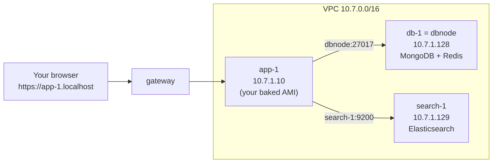

# Multi-tier testing: an app and its databases

A baked app AMI usually boots fine and then crash-loops, because it can't reach
its database. To test it for real, recreate the part of production it talks to:
a VPC with the same CIDR, database instances at the IPs or names the app
expects, and the app instance next to them.

This walkthrough builds this layout:



Replace the names, IPs and engines with what your app uses.

## 1. Find out what the app connects to

Look in the baked AMI (launch it once, or check your build's config files) for
database hosts, without printing secret values:

```bash
docker exec ec2sim-i-<id> grep -rIhoE '(mongodb|redis|postgres|mysql|amqp|https?)://[^"'"'"' ]+' /opt /etc 2>/dev/null \
  | sed -E 's#://[^@/]*@#://***@#' | sort | uniq -c
docker exec ec2sim-i-<id> grep -v '^#' /etc/hosts      # names the build pinned to IPs
```

Check the client library versions too, so you can pick a compatible server.
Old drivers can't talk to the newest servers. For example, Mongoose 5.x needs
MongoDB 4.4 or earlier.

## 2. Create the network

```bash
VPC=$(ec2 create-vpc --cidr-block 10.7.0.0/16 --query Vpc.VpcId --output text)
SUB=$(ec2 create-subnet --vpc-id $VPC --cidr-block 10.7.1.0/24 --query Subnet.SubnetId --output text)
SG=$(ec2 create-security-group --vpc-id $VPC --group-name app-stack --description "app stack" --query GroupId --output text)
ec2 authorize-security-group-ingress --group-id $SG --ip-permissions 'IpProtocol=-1,IpRanges=[{CidrIp=10.7.0.0/16}]'
ec2 authorize-security-group-ingress --group-id $SG --protocol tcp --port 80  --cidr 0.0.0.0/0   # web from your browser
ec2 authorize-security-group-ingress --group-id $SG --protocol tcp --port 443 --cidr 0.0.0.0/0
```

## 3. Database instances, installed with user data

Use user data to install the databases, the same way you would on EC2. A
systemd base AMI makes `systemctl enable` work. Example `db.sh` for MongoDB 4.4
and Redis on Ubuntu 18.04:

```bash
#!/bin/bash
set -ex
export DEBIAN_FRONTEND=noninteractive
apt-get update && apt-get install -y curl gnupg ca-certificates
curl -fsSL https://pgp.mongodb.com/server-4.4.asc | apt-key add -
echo "deb [arch=amd64] https://repo.mongodb.org/apt/ubuntu bionic/mongodb-org/4.4 multiverse" \
  > /etc/apt/sources.list.d/mongodb-org-4.4.list
apt-get update && apt-get install -y mongodb-org redis-server
sed -i 's/^\s*bindIp:.*/  bindIp: 0.0.0.0/' /etc/mongod.conf
sed -i 's/^bind 127.*/bind 0.0.0.0/; s/^protected-mode yes/protected-mode no/' /etc/redis/redis.conf
systemctl enable --now mongod
systemctl restart redis-server
```

Example `search.sh` for Elasticsearch 8 as a single node with security off,
for apps that use plain `http://…:9200`:

```bash
#!/bin/bash
set -ex
apt-get update && apt-get install -y curl ca-certificates
useradd -r -m -d /opt/elasticsearch es || true
curl -fsSL https://artifacts.elastic.co/downloads/elasticsearch/elasticsearch-8.5.3-linux-x86_64.tar.gz \
  | tar xz -C /opt/elasticsearch --strip-components=1
cat >> /opt/elasticsearch/config/elasticsearch.yml <<YML
network.host: 0.0.0.0
discovery.type: single-node
xpack.security.enabled: false
node.store.allow_mmap: false
YML
chown -R es:es /opt/elasticsearch
cat > /etc/systemd/system/elasticsearch.service <<UNIT
[Unit]
After=network.target
[Service]
User=es
Environment=ES_JAVA_OPTS=-Xms512m -Xmx512m
ExecStart=/opt/elasticsearch/bin/elasticsearch
LimitNOFILE=65535
[Install]
WantedBy=multi-user.target
UNIT
systemctl daemon-reload && systemctl enable --now elasticsearch
```

`node.store.allow_mmap: false` avoids changing `vm.max_map_count`. That's a
kernel setting shared by every container on the host.

Launch the instances at the IPs the app expects:

```bash
ec2 run-instances --image-id ami-0ec2511b180400001 --subnet-id $SUB --security-group-ids $SG \
  --private-ip-address 10.7.1.128 --user-data file://db.sh \
  --tag-specifications 'ResourceType=instance,Tags=[{Key=Name,Value=db-1}]'
ec2 run-instances --image-id ami-0ec2511b180400001 --subnet-id $SUB --security-group-ids $SG \
  --private-ip-address 10.7.1.129 --user-data file://search.sh \
  --tag-specifications 'ResourceType=instance,Tags=[{Key=Name,Value=search-1}]'
```

Wait until they answer (1 to 3 minutes):

```bash
docker exec ec2sim-i-<db-1> sh -c 'mongo --quiet --eval "db.version()"; redis-cli ping'
docker exec ec2sim-i-<search-1> curl -s localhost:9200/_cluster/health
```

## 4. Launch the app from your AMI

```bash
ec2 run-instances --image-id ami-<your-app-ami> --instance-type t3.large \
  --subnet-id $SUB --security-group-ids $SG --private-ip-address 10.7.1.10 \
  --tag-specifications 'ResourceType=instance,Tags=[{Key=Name,Value=app-1}]'
```

Names resolve in two ways:

- Each instance's **Name tag**: `db-1` and `search-1` resolve automatically.
- **Names your build pinned in `/etc/hosts`**, e.g. `10.7.1.128 dbnode`. These
  come back with the AMI and now point to the database instance you placed at
  that IP.

## 5. Check it

```bash
docker exec ec2sim-i-<app-1> systemctl --failed
docker exec ec2sim-i-<app-1> systemctl show -p NRestarts <service>    # should stay at 0
docker exec ec2sim-i-<db-1> mongo --quiet --eval 'db.adminCommand({listDatabases:1}).databases.map(d=>d.name)'
curl -sk -o /dev/null -w '%{http_code}\n' https://app-1.localhost/
```

The app's nginx serves several sites by host name. To test each one, send the
real host name to the instance IP (Linux/WSL):

```bash
curl -sk --resolve www.example.com:443:10.7.1.10 https://www.example.com/
```

To use a database GUI from your computer, add a port forward:
`uv run ec2-sim forward i-<db-1> 27017 --local 27017`.

## What this tells you, and what it doesn't

It tells you that the AMI boots, its services start, read their config,
connect to their databases, create schemas and indices, and serve HTTP and
HTTPS. Missing directories, wrong permissions and units that crash-loop show up
here instead of in production.

It doesn't reproduce managed AWS services the app calls directly, such as SQS,
S3 and SES. Those calls still go to real AWS with whatever credentials the
instance has, or fail. Point the app at local stand-ins if you need them, and
treat those failures as expected in this test.

## Clean up

```bash
ec2 terminate-instances --instance-ids i-… i-… i-…
ec2 deregister-image --image-id ami-…      # if it contains secrets
```

Stopping the server also removes all instances and networks. AMIs stay.
