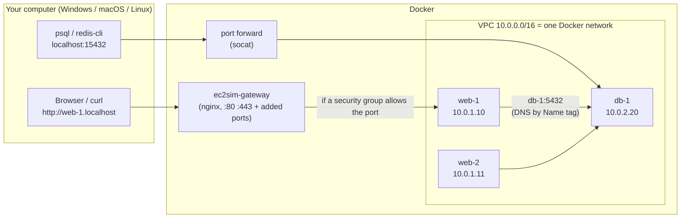

# Networking

Instances reach each other the way they would inside a VPC. From your computer
you reach them three ways: by name through the HTTP gateway, through port
forwards, or by IP on Linux and WSL.



## Instance ↔ instance

- **One VPC = one Docker network** with the VPC's CIDR. Instances in any subnet
  of the VPC reach each other, as in AWS. Different VPCs stay isolated.
- **IPs come from the subnet**, and `--private-ip-address` is honoured, so you
  can recreate a fixed layout (e.g. a database at `10.7.1.128`).
- **DNS**: each instance resolves the others by **Name tag** (`db-1`),
  **instance ID**, `ip-10-0-2-20`, and private DNS name
  (`ip-10-0-2-20.<region>.compute.internal`; `…ec2.internal` in us-east-1).
- **Baked `/etc/hosts`** entries come back on instances launched from the AMI,
  so a host name your build hard-codes works once an instance with that IP
  exists.
- Security groups **don't filter** traffic between instances; everything inside
  a VPC can talk.

```bash
VPC=$(ec2 create-vpc --cidr-block 10.0.0.0/16 --query Vpc.VpcId --output text)
SUB=$(ec2 create-subnet --vpc-id $VPC --cidr-block 10.0.1.0/24 --query Subnet.SubnetId --output text)
ec2 run-instances --image-id ami-0ec2511b240400001 --subnet-id $SUB --private-ip-address 10.0.1.20 \
  --tag-specifications 'ResourceType=instance,Tags=[{Key=Name,Value=db-1}]'
```

## Your computer → web apps, by name (HTTP gateway)

The gateway is on by default on ports **80 and 443** of `127.0.0.1`:

| URL | Goes to |
|---|---|
| `http://web-1.localhost/` | port 80 of the instance named `web-1` |
| `https://web-1.localhost/` | port 443, **TLS passthrough** (the instance's own certificate) |
| `http://web-1.localhost:9404/` | port 9404, after `ec2-sim gateway add-port 9404` |
| `http://i-0123….localhost/` | by instance ID, for instances without a Name |

`*.localhost` always resolves to your own machine in browsers and curl, on
Windows, macOS and Linux. When ec2-sim runs in WSL, Windows reaches it through
WSL's localhost forwarding. You don't need DNS or hosts-file changes. Apps must
listen on `0.0.0.0`, not only on `127.0.0.1`.

### Who can be reached: security groups

A port is reachable only if one of the instance's security groups allows
**inbound TCP on that port (or all traffic) from an IP range**, such as
`0.0.0.0/0` or your LAN's range, as for a public instance on AWS. Otherwise the
gateway answers **403** and says which rule to add. Rules that reference
another security group don't count, because they describe instance-to-instance
traffic. Changes take effect within about 2 seconds.

```bash
ec2 authorize-security-group-ingress --group-id sg-… --protocol tcp --port 80 --cidr 0.0.0.0/0
ec2 revoke-security-group-ingress    --group-id sg-… --protocol tcp --port 80 --cidr 0.0.0.0/0
```

Overrides:

- The tag `ec2sim:web` on an instance replaces its groups' rules for the
  gateway: `80,9404`, `all`, or `none`.
- `EC2SIM_GATEWAY_ACCESS=open` lets every port through, for every instance.

In the app: **Connect → Browser** shows each port as Allowed or Blocked, and
gives you Allow and Revoke buttons.

### More gateway ports

```bash
uv run ec2-sim gateway                 # list ports
uv run ec2-sim gateway add-port 9404   # saved in ~/.ec2-sim/gateway-ports
uv run ec2-sim gateway remove-port 9404
```

`EC2SIM_GATEWAY_PORTS` sets the starting list (`""` turns the gateway off), and
`EC2SIM_GATEWAY_BIND` sets the address it listens on.

## Your computer → any port (port forwards)

For databases and other non-HTTP services:

```bash
uv run ec2-sim forward i-0123… 5432 --local 15432   # localhost:15432 → instance:5432
uv run ec2-sim forwards                              # list
uv run ec2-sim unforward ec2sim-fwd-…                # remove (or --all)
```

A forward is published on your machine's localhost. With ec2-sim in WSL,
Windows can use it too; on Docker Desktop, the macOS or Windows host can.
Forwards aren't filtered by security groups, since you created them on purpose.
They disappear when the instance terminates or the server stops. In the app:
**Instances → ⋯ → Port forward**.

## By IP

On Linux and WSL (native Docker Engine), instance IPs are routable from the host
itself: `ssh ubuntu@10.0.1.20`. On Docker Desktop they aren't, so use the
[bastion](../README.md#macos-and-docker-desktop) for SSH and the gateway or
forwards for everything else.
