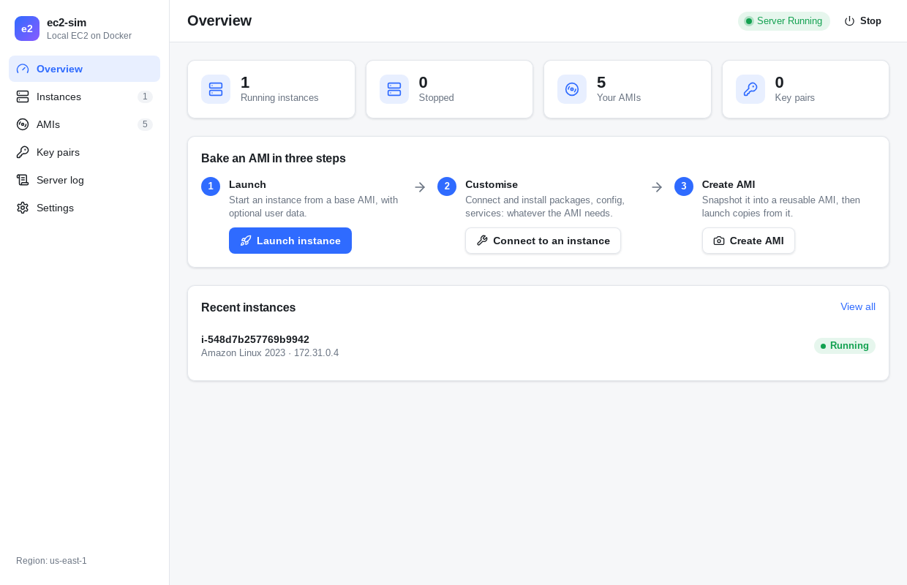
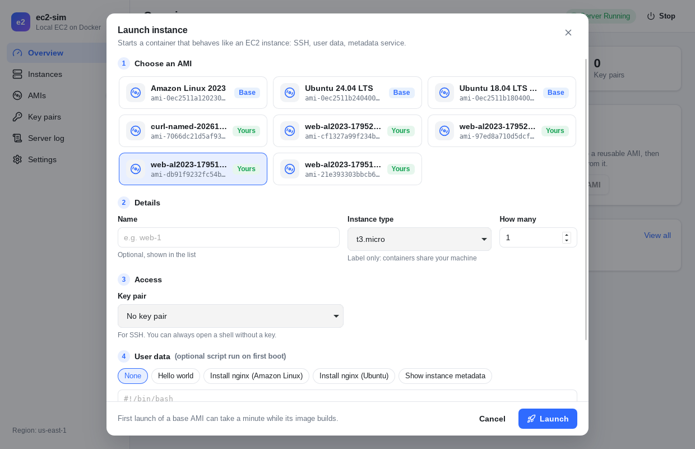
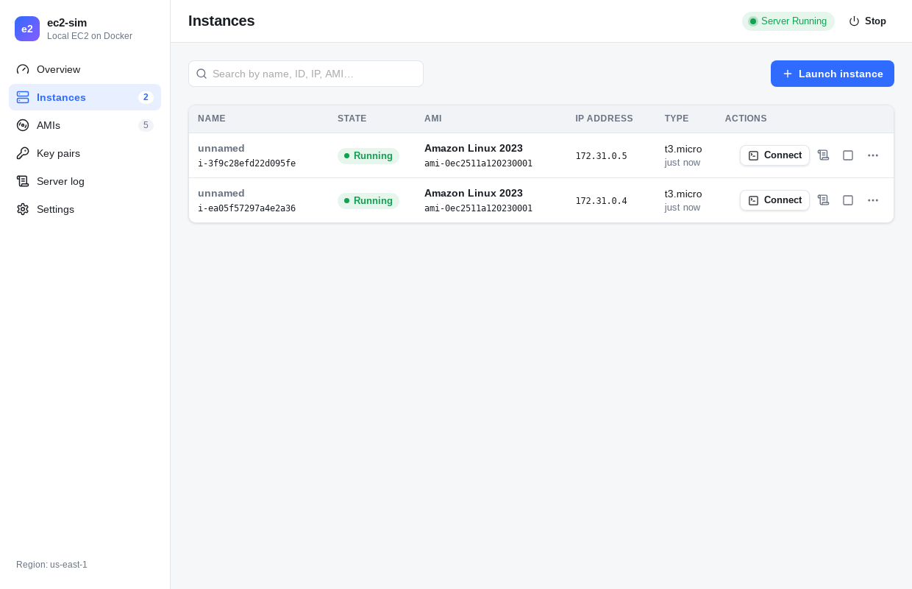
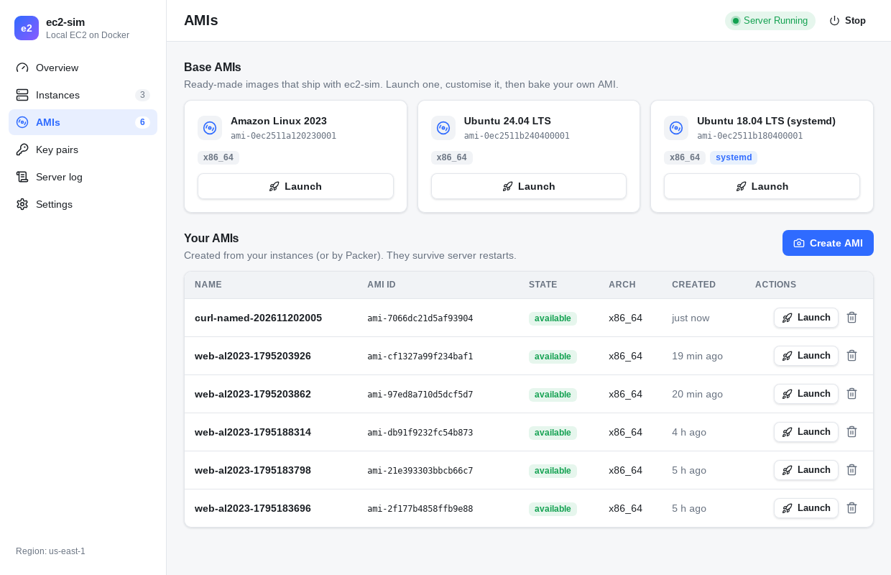

# ec2-sim desktop app

A desktop UI for [ec2-sim](../README.md), built with [Tauri 2](https://tauri.app)
(Rust) and React. Start the simulator, launch instances, connect to them, and
bake AMIs without touching the command line.



| Launch wizard | Instances | AMIs |
|---|---|---|
|  |  |  |

## What you can do

- **Start/stop the simulator** from the top bar. The app runs ec2-sim from your
  checkout, streams its log (**Server log**), and stops it cleanly when you quit,
  so instance containers are removed. A server you started yourself is shown as
  *external* and left alone.
- **Launch instances** with a guided wizard: pick an AMI (base or your own),
  name, type, key pair (or create one on the spot), and optional user data from
  ready-made templates.
- **Connect** to an instance:
  - *Shell*: a root shell via `docker exec`, no key needed.
  - *SSH*: the exact `ssh` command, with your saved key and, on Docker Desktop,
    the bastion jump host.
  
  Both can open your terminal directly or copy the command.
- **Console**: user-data output and the instance's boot log.
- **Start / Stop / Reboot / Terminate** from each row, with confirmation for destructive actions.
- **Bake an AMI** from any instance (optionally stopping it first, like Packer),
  then launch copies from **AMIs**. Deregister AMIs you no longer need.
- **Key pairs**: create and delete them. Private keys are saved to `~/.ec2-sim/keys/<name>.pem` (mode 600).
- **Settings**: ec2-sim folder, endpoint, region, auto-start, and extra
  environment for the server (e.g. `EC2SIM_AMI_ALIASES`).

## Run it

Requirements: everything ec2-sim needs (Docker, uv), plus Rust (stable) and
Node.js 20.19+. On Linux, also the WebKitGTK build dependencies
(`libwebkit2gtk-4.1-dev`, `build-essential`, `libssl-dev`, `libayatana-appindicator3-dev`,
`librsvg2-dev`); see Tauri's [prerequisites](https://tauri.app/start/prerequisites/).

```bash
cd ui
npm install
npm run tauri dev        # development, with hot reload
npm run tauri build      # release build + installers in src-tauri/target/release/bundle/
```

The app looks for ec2-sim in the repository it was built from (`ui/..`). Change
it under **Settings → ec2-sim folder** if you move things.

Notes:

- **WSL2:** the window opens through WSLg. If it renders blank, run with
  `WEBKIT_DISABLE_DMABUF_RENDERER=1`.
- **macOS/Windows (Docker Desktop):** ec2-sim switches to bastion mode
  automatically; the Connect dialog builds the SSH command accordingly.
- **Open in terminal** uses Terminal.app on macOS, `cmd` on Windows, and the first
  working one of `x-terminal-emulator`, `gnome-terminal`, `konsole`,
  `xfce4-terminal`, `kitty`, `alacritty`, `xterm` on Linux. If none works, copy
  the command instead.

## How it works

- `src-tauri/src/`:
  - `server.rs` starts and stops the ec2-sim process and streams its log to the UI.
  - `ec2.rs` sends EC2 Query API calls to ec2-sim and converts the XML responses to JSON.
  - `host.rs` handles Docker (console output, network mode), terminals and key files.
  - `settings.rs` stores preferences in the OS config dir (`ec2-sim-ui/settings.json`).
- `src/`: the React app.
  - `api.ts`: typed command wrappers and response parsing.
  - `store.tsx`: shared state, polled every 1.5 to 4 seconds.
  - `pages/`: the screens.
  - `ui.tsx`: buttons, modals, toasts.

The app talks to ec2-sim only through its public EC2 API and Docker, so it works
with any ec2-sim server on the configured endpoint.
